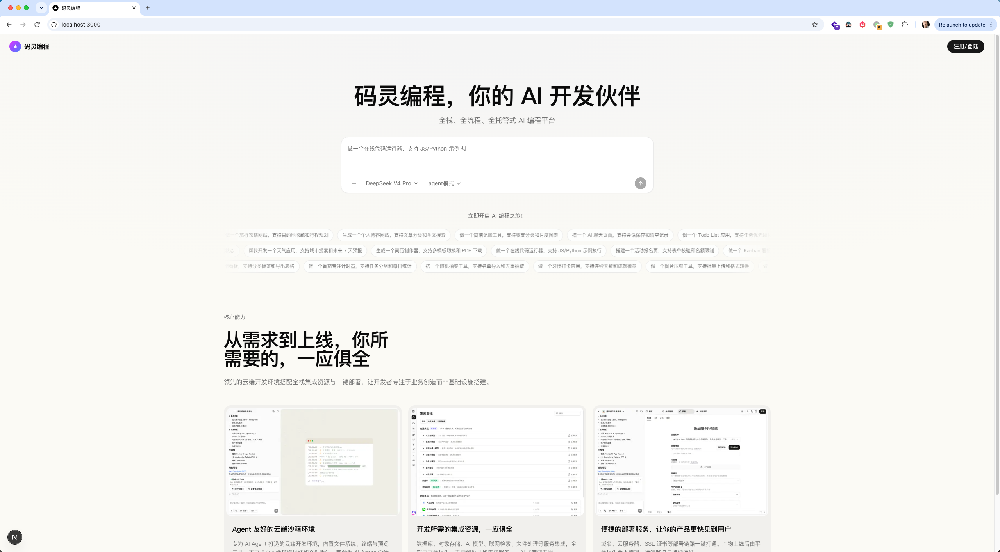
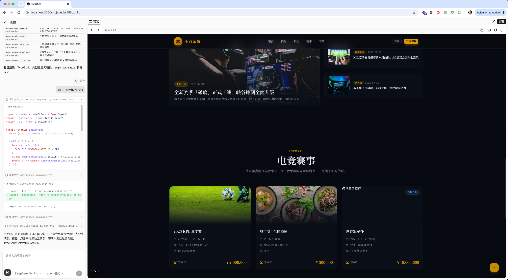

# code-agent

[](LICENSE)

[中文](README.md) | [English](README.en.md)





Welcome to CodeGenie — an open-source AI developer workspace that lets you pick your preferred LLM for every prompt. Build full-stack web apps in the browser, with support for mainstream model providers (OpenAI, Anthropic, Gemini, Kimi, xAI, DeepSeek, and more), extensible with any provider. DeepSeek, Anthropic, and OpenAI are enabled by default; the rest can be enabled and configured in Settings.

## Architecture

```
Next.js (web)  ──SSE──▶  FastAPI + LangGraph (api)  ──▶  k8s Sandbox Pod (per session)
React SPA (admin) ──REST──┘
```

- **apps/web** — Next.js user-facing app: chat + streaming rendering
- **apps/admin** — React SPA (Vite) admin console
- **apps/api** — Python backend, FastAPI + LangGraph, streaming output over SSE
- **deploy/** — infrastructure services the project needs to run

## Local Preview / Development

Local development takes three parts, in order: sandbox infrastructure (k8s), dependency services (Postgres + Redis), and the apps themselves (api + web + admin).

### Prerequisites

- **OrbStack** (or another local k8s cluster; OrbStack is what's been tested, and it bundles kubectl and Docker)
- **Node 24+** + **pnpm** + **Python 3.12+** + **uv**

### 1. Build and deploy the sandbox infrastructure

Sandboxes run in k8s, so you first install the controller, the router, build the image, and configure the wildcard Ingress. Full flow:

```bash
# 1.1 Install the agent-sandbox control plane (Sandbox CRD + controller)
deploy/api/agent-sandbox/install.sh

# 1.2 Install the router (data plane — the SDK connects to its sandbox-router-svc)
deploy/api/agent-sandbox-router/install.sh

# 1.3 Build the base sandbox image (Next.js template + Node 24 + official runtime)
docker build -f deploy/api/sandbox-image/Dockerfile \
  -t code-agent/sandbox-base:latest .

# docker build only writes to Docker's image store; it does not sync into the
# cluster node's containerd. Without importing it, kubelet hits the old image
# already on the node (the event says "already present on machine") and your
# build never takes effect. Find the node name with `kubectl get nodes`.
docker save code-agent/sandbox-base:latest \
  | docker exec -i xxx-name-space ctr -n k8s.io images import -

# Confirm the node really has the image you just built (digest should match
# `docker images --digests`)
docker exec xxx-name-space \
  ctr -n k8s.io images ls | grep sandbox-base

# 1.4 Deploy the sandbox template and warm pool (WarmPool replicas must be set
# to 1 to pre-warm; the default is 0)
# Edit deploy/api/sandbox-warmpool/index.yaml and set spec.replicas to 1
kubectl apply -f deploy/api/sandbox-image/index.yaml
kubectl apply -f deploy/api/sandbox-warmpool/index.yaml

# 1.5 Configure the wildcard Ingress (so sandboxes are reachable at
# http://<id>.localtest.me)
deploy/api/sandbox-ingress/install.sh
```

#### Verify the sandbox infrastructure

```bash
# Controller running
kubectl -n agent-sandbox-system get pod
# You should see both the agent-sandbox-controller and sandbox-router pods Running

# Warm pool has one standby sandbox
kubectl get sandboxes -A
# You should see python-sandbox-warmpool-xxxxx with STATUS = Ready

# Ingress configured
kubectl get ingress -n agent-sandbox-system sandbox-wildcard
# You should see *.localtest.me and *.k8s.orb.local rules
```

### 2. Start the dependency services

Postgres (LangGraph checkpointer) and Redis (sessions/cache) run locally via docker-compose:

In `.env`, fill in at least `CODE_AGENT_API_KEY` and `CODE_AGENT_API_URL`.

```bash
# 2.1 Prepare environment variables
cp apps/api/.env.example apps/api/.env

# 2.2 Start Postgres + Redis (ports 5433 / 6380, avoiding 5432 / 6379)
docker-compose up -d

# 2.3 Apply database migrations
uv run alembic upgrade head

cd ../..   # back to the repo root
```

### 3. Install app dependencies and start

Everything's in place now, so the front end and back end can come up:

```bash
# 3.1 Prepare the front-end env vars (web needs the backend address; falls back
# to http://localhost:8000 if unset)
cp apps/web/.env.example apps/web/.env
# admin needs no .env: the dev server proxies /api to 127.0.0.1:8000 by default.
# To point elsewhere, pass it ad hoc: VITE_API_TARGET=http://... make dev-admin

# 3.2 Install all front-end and back-end dependencies (from the repo root)
make install
# Or individually (the repo is not a pnpm workspace, so each app installs its own):
#   cd apps/web   && pnpm install
#   cd apps/admin && pnpm install
#   cd apps/api   && uv sync

# 3.3 Start the backend (FastAPI :8000)
make server

# 3.4
make dev-web

# To start just one:
# make dev-web      # Next.js (http://localhost:3000)
# make dev-admin    # React SPA (http://localhost:5174)
# make server       # FastAPI (http://localhost:8000)
```

#### Verify the apps are running

```bash
# API health check
curl http://localhost:8000/health
# Expect {"status":"ok"}

# Web front end (open in browser)
open http://localhost:3000
```

## License

This project is released under the [MIT License](LICENSE).

