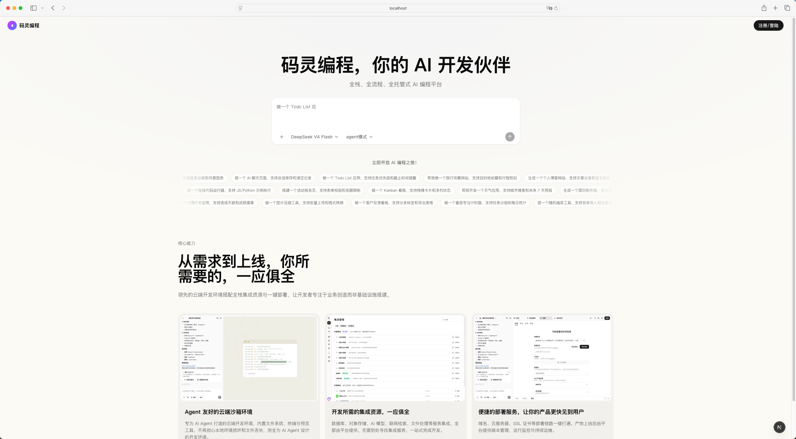
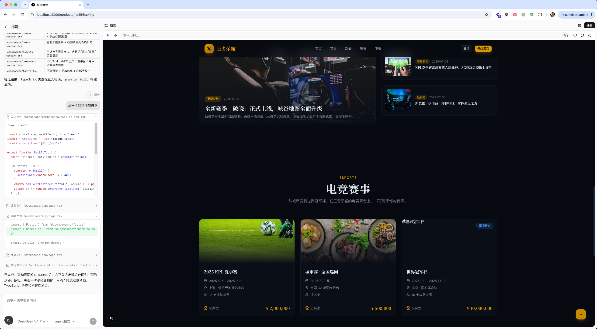

# 码灵编程

[](LICENSE)

[中文](README.md) | [English](README.en.md)






欢迎使用 码灵编程 —— 一个开源的 AI 开发者工作台，让你为每一次提示自由选择偏好的大模型。你可以在浏览器里构建全栈 Web 应用，支持主流模型提供商（OpenAI、Anthropic、Gemini、Kimi、xAI、DeepSeek 等），任何提供商来扩展。默认启用的是 DeepSeek、Anthropic、OpenAI；其余提供商在设置中启用并配置。


## 架构

```
Next.js (web)  ──SSE──▶  FastAPI + LangGraph (api)  ──▶  k8s Sandbox Pod (per session)
React SPA (admin) ──REST──┘
```

- **apps/web** — Next.js 用户端，对话 + 流式渲染
- **apps/admin** — React SPA（Vite）管理台
- **apps/api** — Python 后端，FastAPI + LangGraph，SSE 流式输出
- **deploy/** — 项目运行需要的各种服务


## 启动本地预览/开发

本地开发需要按顺序完成三部分：沙箱基础设施（k8s）、依赖服务（Postgres + Redis）、应用本体（api + web + admin）。

### 前置软件安装

- **OrbStack**（或其他本地 k8s 集群，已测试 OrbStack，包含了kubectl，Docker）
- **Node 24+** + **pnpm** + **Python 3.12+** + **uv**

### 1. 构建并部署沙箱基础设施

沙箱在 k8s 里运行，需先装控制器、router、构建镜像、配置通配 Ingress。完整流程：

```bash
# 1.1 安装 agent-sandbox 控制面（Sandbox CRD + controller）
deploy/api/agent-sandbox/install.sh

# 1.2 安装 router（数据面，SDK 要连的就是它的 sandbox-router-svc）
deploy/api/agent-sandbox-router/install.sh

# 1.3 构建沙箱基础镜像（Next.js 模板 + Node 24 + 官方运行时）
docker build -f deploy/api/sandbox-image/Dockerfile \
  -t code-agent/sandbox-base:latest .

# docker build 只写进 Docker 的镜像库，不会同步到集群节点的 containerd。
# 不导入的话 kubelet 会命中节点里那份旧镜像（事件里显示 "already present on
# machine"），新构建的内容根本不生效。节点名用 `kubectl get nodes` 查。
docker save code-agent/sandbox-base:latest \
  | docker exec -i xxx-name-space ctr -n k8s.io images import -

# 核对节点里确实是刚构建的那份（digest 应与 `docker images --digests` 一致）
docker exec xxx-name-space \
  ctr -n k8s.io images ls | grep sandbox-base

# 1.4 部署沙箱模板与预热池（WarmPool replicas 改成 1 才会预热，默认是 0）
# 编辑 deploy/api/sandbox-warmpool/index.yaml，把 spec.replicas 改为 1
kubectl apply -f deploy/api/sandbox-image/index.yaml
kubectl apply -f deploy/api/sandbox-warmpool/index.yaml

# 1.5 配置通配 Ingress（让沙箱能通过 http://<id>.localtest.me 访问）
deploy/api/sandbox-ingress/install.sh
```

#### 验证沙箱基础设施

```bash
# 控制器运行
kubectl -n agent-sandbox-system get pod
# 应能看到 agent-sandbox-controller 和 sandbox-router 各自的 Pod 都 Running

# 预热池有一个待命沙箱
kubectl get sandboxes -A
# 应能看到 python-sandbox-warmpool-xxxxx，STATUS = Ready

# Ingress 配置就绪
kubectl get ingress -n agent-sandbox-system sandbox-wildcard
# 应能看到 *.localtest.me 和 *.k8s.orb.local 规则
```

### 2. 启动依赖服务

Postgres（LangGraph checkpointer）和 Redis（会话/缓存）通过 docker-compose 在本地起：

.env，至少要填`CODE_AGENT_API_KEY`， `CODE_AGENT_API_URL`

```bash
# 2.1 准备环境变量
cp apps/api/.env.example apps/api/.env

# 2.2 启动 Postgres + Redis（端口 5433 / 6380，避开 5432 / 6379）
docker-compose up -d

# 2.3 应用数据库迁移
uv run alembic upgrade head

cd ../..   # 回到仓库根
```

### 3. 安装应用依赖并启动

现在依赖都就绪，可以起前后端了：

```bash
# 3.1 准备前端环境变量（web 要知道后端地址，不填会回退到 http://localhost:8000）
cp apps/web/.env.example apps/web/.env
# admin 不需要 .env：dev server 默认把 /api 代理到 127.0.0.1:8000，
# 要改后端地址就临时传 VITE_API_TARGET=http://... make dev-admin

# 3.2 安装所有前后端依赖（根目录执行）
make install
# 或分别执行（仓库不是 pnpm workspace，依赖按 app 各自安装）：
#   cd apps/web   && pnpm install
#   cd apps/admin && pnpm install
#   cd apps/api   && uv sync

# 3.3 启动后端（FastAPI :8000）
make server

# 3.4 
make dev-web

# 若只想起某一个：
# make dev-web      # Next.js (http://localhost:3000)
# make dev-admin    # React SPA (http://localhost:5174)
# make server       # FastAPI (http://localhost:8000)
```

#### 验证应用运行

```bash
# API 健康检查
curl http://localhost:8000/health
# 期望返回 {"status":"ok"}

# Web 前端（浏览器打开）
open http://localhost:3000
```

## 许可证

本项目采用 [MIT License](LICENSE) 开源。


